# What Did the Destruction of the Kakhovka Dam Do to Vegetation? Separating Flood, Reservoir and Irrigation Effects with Satellite Data

**Sakshi D. Maske**

*Independent Geospatial Researcher*

## Abstract

The Kakhovka Dam in southern Ukraine was destroyed on 6 June 2023. This could have changed vegetation in three ways: through the flood below the dam, the draining of the reservoir, and the loss of water for the irrigation canals. All three happened inside an active war zone.

I tested each pathway separately with MODIS NDVI at 250 m resolution for 2016–2024. Treated land was defined by what physically happened to it and compared with similar land in the same war zone. I made the analysis plan public before downloading any data, and later wrote two registered revisions, each before the extra data it needed were downloaded.

- **Flooded land** showed no detectable lasting loss of July–October greenness. Matched on terrain and land cover (59% of flooded pixels), the change was −0.004 NDVI (95% CI −0.021 to 0.013; placebo p = 0.42); over all flooded pixels it was +0.012 (−0.003 to 0.028). Floodplain wetlands are the exception (−0.04 to −0.06).
- **Irrigated farmland.** With independent 30 m irrigation maps (Baber et al., 2026), fields irrigated in 2019–2021 lost 0.18 NDVI (95% CI 0.15 to 0.21; a third of their 2016–2018 level) in 2023–2024 relative to cropland that was never irrigated, after a small step in 2022 (−0.03). The pre-registered rule calls this *suggestive*: the irrigated fields were already greener in 2019–2021, the years used to identify them, so the placebo test fails. An NDVI-based irrigation proxy used in the first two analyses agreed with the independent maps on only 16% of its "irrigated" pixels in Kherson Oblast.
- **The drained reservoir bed** changed the most: the area with NDVI above 0.3 grew from 86–100 km² in each year before the breach to 1,574 km² in 2024. Sentinel-2 agrees with MODIS within 18% where both can be compared.

In Kherson Oblast, previously irrigated cropland, 4% of the area, accounted for −0.008 of a −0.020 relative change in July–October NDVI between 2016–2018 and 2023–2024 (95% intervals exclude zero); the flood accounted for almost none. Satellite data clearly show what happened to the reservoir and point to a large loss of greenness where canal irrigation stopped, but separating that loss from the war's other effects remains uncertain.

**Keywords**: Kakhovka Dam, armed conflict, NDVI, MODIS, pre-registration, difference-in-differences, irrigation, reservoir drawdown, ecocide

---

## 1. Introduction

On 6 June 2023 the Kakhovka Dam on the lower Dnipro River was destroyed. The reservoir behind it held about 18 km³ of water at full capacity (Vyshnevskyi et al., 2023). It emptied within days. The floodplain between the dam and the Dnipro–Buh estuary was flooded. The main irrigation canals of southern Ukraine lost their water source (Shumilova et al., 2025). The event is one of the most cited examples of environmental harm in the war and is often mentioned in debates about making ecocide an international crime.

To link a change in the environment to one act, we need to know what would have happened without that act. In southern Ukraine this is hard. The region had been a battlefield since February 2022. The left bank of the Dnipro was occupied. Farming was disrupted, and vegetation changes from year to year with the weather.

In an earlier version of this work (Study 1, Section 3) I compared the average NDVI of the whole of Kherson Oblast with four counties in Romania. Kherson became less green after June 2023, and the difference was statistically significant. But that design could not show that the dam caused the change.

This paper uses a different design. I asked three questions, one for each pathway:

1. Did land that was flooded lose greenness compared with similar land that was not flooded?
2. Did farmland irrigated from the reservoir's canals lose greenness compared with farmland that was never irrigated?
3. What happened to vegetation on the drained reservoir bed?

I then used the answers to split Kherson Oblast's overall change into parts.

I wrote the full analysis plan before downloading any data and made it public on GitHub. The plan also fixed the words I would use to describe each result. When the first results showed five problems in the design, I wrote a registered revision before collecting the extra data it needed. A review of the project then found six more, the most serious being that my NDVI-based irrigation measure did not measure irrigation. I wrote a second registered revision, again before downloading its data, that uses independent irrigation maps, matches flooded land on terrain instead of past greenness, and lets weather change the irrigated–non-irrigated contrast. I report all three sets of results.

The three pathways behave very differently. The reservoir bed turned green on a large scale. I found no lasting loss of greenness on the flooded land, except in wetlands. Fields that had been irrigated lost about a third of their summer greenness after the breach relative to fields that were never irrigated, but the test of this fails one of its pre-registered conditions, so the result is named suggestive. An average over a whole oblast mixes all of these with the war's wider effects.

## 2. Background

### 2.1 Legal context

Article 8(2)(b)(iv) of the Rome Statute covers attacks that cause "widespread, long-term and severe damage to the natural environment" (Rome Statute, 1998). In September 2024 Vanuatu, Fiji and Samoa proposed adding a separate crime of ecocide to the Statute (Stop Ecocide International, 2024). Ukraine's Criminal Code already has such a crime (Article 441), and Belgium added one in 2024 (Atılgan Pazvantoğlu, 2025). How it would apply in war is still debated (Killean, 2025).

Any case would need evidence that links an environmental change to a specific act. Satellite images have been used in international courts, for example in *Prosecutor v. Al Mahdi* (2016). They have mostly supported other evidence, and there are no agreed rules for how to read them in numbers (Kroker, 2015; Wang et al., 2013).

### 2.2 What is already known about the Kakhovka event

**The dam and the flood.** Satellite data show that the dam was being run in an unusual way for months before it failed, with water overflowing from late April 2023 (Yang et al., 2024). UNOSAT mapped the flood within days from several satellites (UNITAR/UNOSAT, 2023). Field and model studies describe the flood, pollution and effects on rivers and the sea (Shumilova et al., 2025; Vyshnevskyi et al., 2023).

**The reservoir bed.** Kuzemko et al. (2025) combined field surveys with satellite mapping of the drained bed. They found that the number of plant species grew almost fourteen-fold within a year and that willow and poplar thickets spread quickly. This did not match early warnings that the bed would become a desert. Sentinel-2 studies have also mapped how often parts of the bed stayed under water in 2023–2024 (Lischenko et al., 2025) and how NDVI changed across the wider reservoir area in 2023–2025 (Shults, 2025). The greening of the bed itself is therefore well documented; what my H3 result adds is a long MODIS baseline (2016–2024) on the same grid as the other two pathways.

**Irrigation.** Baber et al. (2026a) mapped irrigated fields in Kherson and Zaporizhzhia oblasts for 2019–2025 at 30 m with Sentinel-2, Landsat, rainfall and evapotranspiration data, and published the maps (Baber et al., 2026b). They estimate 188 ± 14 thousand ha of irrigated land on average in 2019–2021, about 4% of the cropland of the two oblasts, falling to 140 thousand ha in 2022, 75 thousand ha in 2023 and 16 thousand ha in 2024. Farmers moved from summer crops to winter wheat and barley (Baber et al., 2026a; NASA Harvest, n.d.). Their maps for 2023–2025 are less accurate than for earlier years. They measure where irrigation stopped, not what its loss did to vegetation, and they do not compare the canal system with land outside it. Pichura and Potravka (2025) describe the wider irrigation zone after the breach: more fires, hotter soil surfaces and topsoil loss, with irrigated land under Ukrainian control down to 18% of the 2020 area. Their study has no comparison group.

**War and farmland.** Satellite data have long been used to study the effects of armed conflict on land (Witmer, 2015), including cropland loss in eastern Ukraine after 2014 (Skakun et al., 2019). Kussul et al. (2025) found that Ukraine's arable land shrank by about 10% after the invasion, with more than 5 million hectares left uncultivated by 2024. Wagner et al. (2025) showed that abandoned cropland is concentrated near the front line and where fighting is heavy. Any dam effect in southern Ukraine therefore sits on top of a large war effect.

### 2.3 Methods for attributing change to one event

Difference-in-differences compares the change in an exposed group with the change in a similar unexposed group (Roth et al., 2023). Three of its known weaknesses matter here. First, when the comparison group is chosen by matching on the outcome before the event, the pre-event trends look parallel by construction, and regression to the mean can create or hide an effect (Daw & Hatfield, 2018). In land-cover studies, matching on fixed site characteristics and then using panel regression is the recommended combination (Jones & Lewis, 2015). Second, when only one or a few areas are treated, standard errors clustered at a smaller scale overstate certainty, and placebo comparisons are needed (Conley & Taber, 2011). Third, irrigated land is hard to identify from greenness alone, because summer crops and irrigation look alike in optical data (Ozdogan et al., 2010). Riparian vegetation after dam removal can also change for years as water levels and sediment settle (Shafroth et al., 2002), so short post-event windows show only the first stage.

### 2.4 What is missing

Each of the studies above describes one part of the picture. None of them asks how much of the change in vegetation after June 2023 can be assigned to each pathway of the dam's destruction, compared with what would have happened anyway inside the same war zone. That comparison is what legal and recovery questions need.

This paper's contribution is to test all three pathways in one counterfactual design, on one grid, inside the war zone, with the tests and the words for the results fixed in advance. For the flood and irrigation pathways this gives estimates against comparison land, which the studies above do not make; for the reservoir bed it places the documented greening on a long baseline.

## 3. Study 1: why an oblast-wide comparison was not enough

Study 1 used monthly Sentinel-2 NDVI from January 2022 to November 2024. It compared the whole of Kherson Oblast with Tulcea County in Romania and three other Romanian counties.

**What it found.**

- Kherson's NDVI fell relative to Tulcea by 0.108 (95% CI 0.007 to 0.209; p = 0.037).
- With separate seasonal patterns for each area, the fall was 0.069 (p = 0.005).
- A fake event date in June 2022 showed no effect.

**Why this could not show the dam was the cause.**

- When each of the five areas was treated as the "affected" one in turn, Kherson ranked only second (p = 0.40).
- Four of the five quarters before the event already showed differences.
- The flood covered only about 2% of the oblast. Even if every flooded pixel had lost all its vegetation, the oblast average would have moved by only about 0.02.
- The result also changed across three versions of the data processing.

Study 1 therefore showed a real decline, but not its cause. Its problems shaped every choice in Study 2.

## 4. Data and methods

### 4.1 Analysis plans

**Main plan.** I wrote the plan (`ANALYSIS_PLAN_v2.md`) and committed it to the public GitHub repository at 15:33 IST on 24 September 2026 (commit 521672f). The first data file was downloaded about 20 minutes later. The plan fixes:

- the questions;
- how each exposed group is defined;
- the outcome;
- the statistical models and tests;
- nine robustness checks;
- the rule that decides whether a result is called *supported*, *suggestive* or *not supported*.

**Registered revision.** The first results showed five problems (Section 4.8). I wrote a second plan (`ANALYSIS_PLAN_v2_ADDENDUM_1.md`) and committed it at 22:53 IST on the same day (commit 30e3840). This was after I had seen the first results, but before I downloaded the extra data it needed and before I ran any of its analyses.

**Second registered revision.** After an external review (Section 4.9) I wrote `ANALYSIS_PLAN_v2_ADDENDUM_2.md` and committed it to the local repository on 16 October 2026, before downloading the irrigation maps, elevation data and Sentinel-2 images it uses, and before running any of its analyses. Its SHA-256 checksum is recorded in `v2/DEVIATIONS.md`, and the analysis code refuses to run if the file changes. It was not deposited with an independent registry, so its date rests only on my own git commit.

**Deviations.** Every change to the plans, and every choice the plans did not cover, is listed in `v2/DEVIATIONS.md`.

### 4.2 Data

All data were put on one equal-area grid (EPSG:3035) with 231.656 m pixels, the true pixel size of the MODIS 250 m product. The grid covers 29.0–36.5 °E and 45.3–49.3 °N.

| Dataset | Used for | Source |
|---|---|---|
| MODIS Terra MOD13Q1 v061, 16-day composites, 2010–2024 | NDVI and EVI outcomes; irrigation status in the revision | Didan (2021), Microsoft Planetary Computer |
| ESA WorldCover 2021 v200, 10 m | Share of each land-cover class in each pixel | Zanaga et al. (2022) |
| UNOSAT FL20230606UKR | Flood extent; water extent before the breach | UNITAR/UNOSAT (2023) |
| ERA5-Land monthly means, 2015–2024 | July–October rainfall and temperature | Muñoz-Sabater et al. (2021) |
| OpenStreetMap canals | Irrigation network | OpenStreetMap contributors (2026) |
| VIINA events and territorial control, 2022–2024 | War intensity and occupation (revision) | Zhukov (2023) |
| Impact Observatory annual land cover, 2017–2023 | Yearly water share of each pixel (revision) | Karra et al. (2021) |
| GADM v4.1 | Country, oblast and district borders | GADM (2022) |
| Irrigated-field maps, 30 m, 2019–2025 | Irrigation exposure (second revision) | Baber et al. (2026b) |
| Copernicus DEM GLO-30 | Height of each pixel above the river (second revision) | Copernicus DEM, Microsoft Planetary Computer |
| Sentinel-2 L2A, August 2024 | Check of the reservoir-bed result (second revision) | Copernicus Sentinel-2, Microsoft Planetary Computer |

Of the 207 MODIS composites expected for 2016–2024, 204 were in the catalogue. One of the three missing composites (12 August 2024) falls in the outcome window.

**Study pixels.** I used pixels inside Ukraine with at least 90% valid land-cover data. Crimea was left out. This gives 3.49 million pixels.

### 4.3 Outcome

**Main outcome.** The main outcome is the average NDVI of each pixel from July to October of each year.

- Only observations marked good or marginal by MODIS are used.
- Each observation is placed in a season by its own acquisition date.
- A pixel-year is left empty if it has fewer than five valid observations.
- A pixel is used only if it has a value in at least seven of the nine years.

The July–October window means that all of 2023 in the outcome comes after the breach.

**Periods.**

- 2016–2021: before the war
- 2022: the war year before the breach
- 2023–2024: after the breach

**Secondary outcomes.**

- July–August NDVI
- April–October NDVI (without 2023)
- July–October EVI
- for farmland, whether a field was cropped at all

### 4.4 Exposed and comparison groups (Figure 1)

**Flooded land (question 1).**

- A pixel counts as flooded if at least half of it lies inside UNOSAT's combined flood map for 6–9 June 2023 and it is less than 20% permanent water. This gives 9,247 pixels (496 km²) on the two river banks. Of these, 8,626 have the outcome in at least seven of the nine years (the fixed panel), and 8,446 have all six pre-war values needed for matching.
- Comparison pixels lie 2–15 km from the flood, were not flooded in any of the 13 UNOSAT flood maps from June 2023, and are on the same river bank.
- I traced the main channel of the Dnipro through the water that was there before the breach. I used it to split the land into the right bank, which was back under Ukrainian control from November 2022, and the left bank, which stayed occupied.
- Within each bank and land-cover type, each flooded pixel was matched to three comparison pixels with the most similar July–October NDVI in 2016–2021.

**Reservoir bed (question 3).** The reservoir bed is the largest connected body of WorldCover water between the Kakhovka and Zaporizhzhia dams. It covers 1,812 km² on the grid.

**Irrigated and rainfed farmland (question 2).**

- The canal network is the OpenStreetMap canals that start near the reservoir, plus every canal connected to them. This gives 1,879 canal segments, 3,264 km in total.
- The canal zone (K) is cropland within 5 km of this network.
- The comparison zone (O) is cropland more than 30 km from the reservoir and more than 5 km from the network.
- In the main plan, a field counted as irrigated if its July–August NDVI was at least 0.45 in three of the five years 2017–2021. It counted as rainfed if its July–August NDVI was below 0.35 in four of those five years.

**Placebo units.** These are places that were not affected, analysed in exactly the same way as the real ones.

- For the flood: 141 river-side strips 10 km long along the Southern Buh, the lower Dniester and the Dnipro above Zaporizhzhia.
- For irrigation: each oblast of zone O (main plan) or each district (revision), treated as if it were the canal zone.

### 4.5 Models

**Flood (H1).** For pixel *i* in year *y*:

Yiy = αi + λy,s + β·Fi·Posty + δ·Fi·Wary + γ′Wiy + εiy

- αi: pixel effects
- λy,s: year effects for each bank and land-cover group
- F: flooded
- W: July–October rainfall and temperature

**Irrigation (H2).**

Yiy = αi + λy,oblast + μy,irrigated + κy,zone + β·Irri·Ki·Posty + δ·Irri·Ki·Wary + γ′Wiy + εiy

In both models:

- β is the main result: the change after the breach, compared with 2016–2021.
- δ is the change in the war year before the breach.
- The year-by-year version replaces Post and War with one term for each year, with 2021 as the reference.

### 4.6 Tests

- Standard errors are clustered on 10 km blocks.
- A wild cluster bootstrap with 9,999 draws gives p-values that do not depend on large-sample rules (Cameron et al., 2008).
- Conley (1999) standard errors allow for correlation up to 25 km.
- Placebo tests compare the real estimate with the estimates for the placebo units.
- The Holm (1979) correction adjusts for testing two main questions.
- Pre-trends are tested jointly on the 2016–2020 coefficients.
- Confidence intervals are β ± 1.96 standard errors. With 50 clusters in the matched flood sample, a t-based interval is only slightly wider (−0.015 to 0.026 instead of −0.014 to 0.026).
- I used the relative-magnitudes idea of Rambachan and Roth (2023) to ask how large a break from parallel trends would be needed to explain the result. I wrote my own, more conservative version of this step; it is not the HonestDiD software (details in `v2/DEVIATIONS.md`).

### 4.7 Rule for naming results (fixed in the plan)

- **Supported:** β is negative; the Holm-adjusted bootstrap p is below 0.05; the placebo p is below 0.10; and the sensitivity interval at M̄ = 1 excludes zero.
- **Suggestive:** β is negative with p below 0.05, but one of the other conditions fails. Here p is the cluster-robust p-value.
- **Not supported:** all other cases.

### 4.8 What the registered revision changed

The first results showed five problems, and the revision addressed each one.

| Problem | Change in the revision |
|---|---|
| Irrigation status came from the same years as the outcome (2017–2021) | Irrigation status measured from 2010–2015 |
| Outside the dry south, the NDVI rule labelled rainfed summer crops as irrigated | Comparison zone limited to the four steppe oblasts (Odesa, Mykolaiv, Kherson, Zaporizhzhia) |
| Only six placebo oblasts, so the placebo p could not go below 0.14 | Districts used as placebo units |
| War intensity and occupation were not in the models | Added from VIINA: occupation status of the nearest settlement on 1 August, and war events within 5 km. H1 also got year effects by distance to the river channel; H2 got year effects by irrigation and occupation. |
| Each pixel's water share was fixed at 2021, although river levels changed after the breach | Yearly water share from Impact Observatory land cover; pixel-years with more than 10% water, or a change of more than 10 points from 2021, removed |

**Other deviations** (all in `v2/DEVIATIONS.md`):

- A Bartlett kernel was used for the Conley standard errors, because the plan did not name one and a flat kernel failed in the small H1 sample.
- In the flood placebo test, strips with fewer than ten matched pixels were dropped (50 of 141 remain).
- In the revision, only VIINA events classed as military were counted, and contested settlements were treated as not occupied.

### 4.9 Review diagnostics (exploratory)

After all registered results were known, an external review of the project raised two problems with reading H2 and H4. I checked them with `v2/analysis/x1_review_diagnostics.py` (output `outputs/v2/x1_review_diagnostics.json`). These checks are exploratory: they were not in either plan, and they do not change any registered estimate or verdict.

- **Weather.** July–October rainfall and temperature in zone K, from the same ERA5-Land cells the models use, for every year.
- **Placebo districts.** For each placebo district of the revision, the share of its cropland that lies in zone K and the distance of its comparison cropland to the canal network.

### 4.10 What the second registered revision changed

| Problem found in the review | Change in the second revision |
|---|---|
| "Irrigated" was an NDVI proxy that mostly picks up summer crops | Irrigation from the 30 m maps of Baber et al. (2026b): a pixel is *irrigated* if at least half of it was mapped irrigated on average in 2019–2021 and it lies within 30 km of the canal network; *never irrigated* if under 5% was irrigated in each of those years and it lies more than 5 km from any mapped field. The proxy is checked against the maps. |
| Weather entered only as separate terms; the reference year 2021 was the wettest | Rainfall and temperature interacted with the irrigation group; results reported against the 2016–2018 mean |
| Comparison land partly irrigated from the same canals | Comparison is never-irrigated cropland of Kherson and Zaporizhzhia; land near mapped fields excluded |
| Flood matching used pre-war NDVI itself | Matching on height above the river (Copernicus DEM) and WorldCover shares; a placebo-in-time test (match on 2016–2018, "effect" in 2019–2021) measures the bias of outcome matching |
| Clustered p-values too small for one treated area | Flood: placebo floodplains give the main p-value; irrigation: bootstrap with districts as clusters; Conley errors to 100 km |
| H4 had no uncertainty or weather adjustment | 2016–2018 → 2023–2024, weather-adjusted, 95% block-bootstrap intervals |

The irrigation model has pixel effects, year effects by oblast and by occupation, war intensity, and the weather terms; β compares 2023–2024 with 2016–2018, and separate terms absorb 2022 and the defining years 2019–2021. Its placebo test asks whether the irrigated fields already diverged in 2019–2021. The decision rule is the plan's (Section 4.7), with the irrigation placebo test in place of a regional placebo: it must *not* show an effect. A triple difference with irrigated land that did not depend on the canals was planned if at least 1,000 such pixels existed; there were only 133, so it was not run. The second revision also checks the reservoir-bed result against Sentinel-2.

## 5. Results

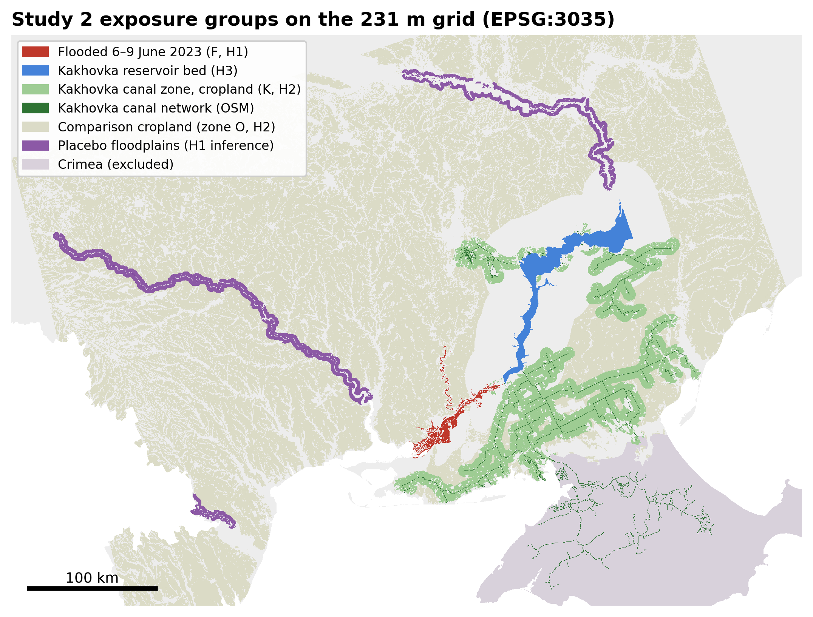

*Figure 1. Flooded land, reservoir bed, canal zone (K), comparison zone (O) and placebo floodplains on the 231 m grid.*

### 5.1 The flood (H1)

**Few good matches.** Before the war, flooded land was much greener in July–October than unflooded land 2–15 km away: the difference was about two standard deviations every year. Most flooded pixels are floodplain wetland or riverside forest, and there is almost no unflooded land like it on the same bank. On the right bank, for example, there were 1,171 flooded wetland pixels but only 24 possible comparison pixels. The planned matching rule therefore found good matches for only 148 of 8,446 flooded pixels (1.8%). For those 148 pixels the match is very close (differences of 0.02 standard deviations or less).

**Main result.**

- β = +0.006 NDVI (95% CI −0.014 to 0.026).
- Bootstrap p = 0.60; Conley standard error 0.014.
- No pre-trend (joint p = 0.74).
- Among 50 placebo floodplains the real estimate is ordinary (placebo p = 0.63).

The result is **not supported**: I found no loss of greenness on flooded land. The matching uses the same six pre-war values that the pre-trend test checks, so a flat pre-trend in this sample is expected by design and is not separate evidence.

**All flooded pixels.** Without matching, using all 8,626 flooded pixels in the fixed panel, the estimate is +0.010 (95% CI −0.004 to 0.025; p = 0.15; placebo p = 0.70 among 141 strips). Because it covers the whole flooded area, this is the more representative estimate. None of the other planned checks shows a decline. One of them, the wider comparison band, shows a significant increase:

| Check | β | p | Matched flooded pixels |
|---|---|---|---|
| Comparison band 5–25 km | +0.024 | 0.007 | 163 |
| No weather terms | +0.004 | 0.68 | 148 |
| Flood threshold 25% | +0.011 | 0.24 | 186 |
| Flood threshold 75% | +0.004 | 0.74 | 137 |
| EVI instead of NDVI | +0.006 | 0.30 | 224 |
| Right bank only | +0.001 | 0.95 | 21 |
| Left bank only | +0.006 | 0.61 | 127 |
| More than 3 km from built-up land | +0.000 | 0.98 | 8 |

**Two patterns inside the flood area.**

- **Wetlands lost greenness.** Flooded wetland pixels fell by 0.059 in the matched sample (p = 0.004; 44 pixels) and by 0.041 over all 4,899 flooded wetland pixels (95% CI −0.061 to −0.020). Flooded grassland, cropland, trees and built-up land show zero or positive changes.
- **A short dip, then regrowth.** Matching without the size limit, which was not in the plan, shows a dip in 2023 (−0.026, p = 0.002) and greener-than-normal land in 2024 (+0.025, p < 0.001; Figure 2). Its pre-trend test fails (p = 0.003), so I treat this only as a description. The planned April–October outcome (without 2023) points the same way: +0.050 (p < 0.001).

**Revision.** With yearly water masks, war intensity and distance to the river added, the matched sample shrinks to 100 flooded pixels.

- Flooded land is greener than its matches after the breach: β = +0.055 (95% CI 0.034 to 0.077), with +0.052 in both 2023 and 2024 (Figure 7).
- Its pre-trend test fails (p = 0.002), and the plan tests for a decline, so the result stays **not supported**.
- Part of this gain may be regression to the mean, because matching on pre-war NDVI picks unusual pixels from both groups. The matched flooded pixels were less green before the war than flooded land as a whole (mean July–October NDVI 0.45 against 0.64), and their matched controls were greener than the candidate controls as a whole (0.45 against 0.40). Both would tend to move back towards their group means, which pushes β upwards.
- Without matching (7,681 pixels) the estimate is +0.012 (p = 0.13).
- Wetlands still decline (−0.061, 95% CI −0.081 to −0.041; 4,258 pixels).

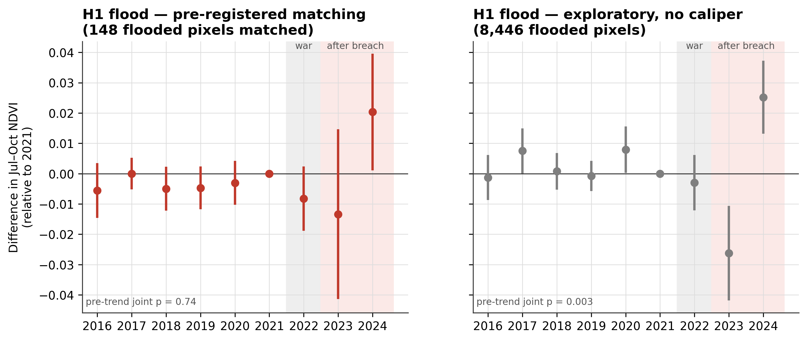

*Figure 2. Flooded minus matched unflooded land, each year compared with 2021. Left: planned matching (148 pixels). Right: matching without the size limit, not in the plan (8,446 pixels). Bars are 95% confidence intervals.*

**Second revision: matching on terrain.** Flooded land is low land, so the second revision matched each flooded pixel to unflooded pixels of the same bank and land-cover type with a similar height above the river and similar land-cover shares, not similar past greenness. This found matches for 5,474 of 9,247 flooded pixels (59%) and removed the imbalance in height (standardised difference −2.34 before, −0.03 after) and in cropland and wetland shares.

- β = −0.004 NDVI (95% CI −0.021 to 0.013; 4,967 flooded pixels in the panel).
- Bootstrap p = 0.68; Conley p = 0.64–0.73 for 25–100 km.
- Among 137 placebo floodplains matched the same way, the real estimate is ordinary (placebo p = 0.42).
- Year by year (Figure 8), the only post-breach departure is a small dip in 2023 (−0.021, 95% CI −0.041 to 0.000) followed by +0.016 in 2024.
- **Placebo in time.** Matching on 2016–2018 NDVI and "estimating" an effect for 2019–2021 gives +0.000 (95% CI −0.007 to 0.008). Matching on the outcome did not by itself create a spurious effect in the pre-war years.
- Without matching, the estimate stays +0.012 (95% CI −0.003 to 0.028; placebo p = 0.67).

The result is **not supported**. Three ways of choosing comparison land — past greenness, terrain and land cover, or none — agree that the flood left no lasting loss of July–October greenness outside the wetlands.

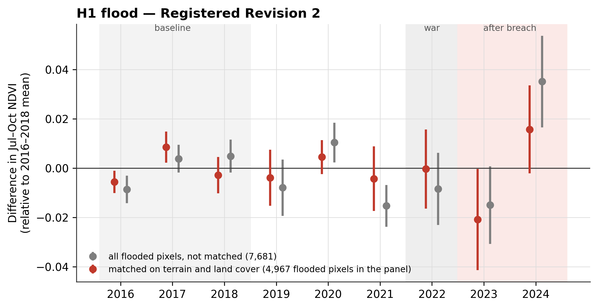

*Figure 8. Second revision, flood: flooded minus comparison land, each year compared with the 2016–2018 mean. Red: matched on height above the river and land cover. Grey: all flooded pixels, not matched. Bars are 95% confidence intervals.*

### 5.2 Irrigated farmland (H2)

**Main plan.**

- The main plan found 97,344 irrigated and 22,926 rainfed pixels in the canal zone, and 1,362,498 irrigated and 106,863 rainfed pixels in the comparison zone.
- The estimate is large: β = −0.074 NDVI (95% CI −0.088 to −0.060). This is 15% of the pre-war level of irrigated land in the canal zone.
- Bootstrap p < 0.001 (Holm 0.0002).
- It holds across the planned checks (−0.062 to −0.092), except in the Zaporizhzhia part of the canal zone (−0.019, p = 0.10).

But the year-by-year results (Figure 3) show that this is not a change that starts with the breach:

- The canal-zone contrast was 0.05–0.07 higher in every year from 2016 to 2020 than in 2021.
- It was +0.029 in 2022, −0.016 in 2023 and −0.030 in 2024.
- The pre-trend test fails badly (p < 10⁻³⁸).
- Among six placebo oblasts, the canal zone had the most negative estimate (Figure 4). With only six placebos, the smallest possible p is 0.14.

**Revision.**

- With irrigation measured from 2010–2015, the comparison limited to the steppe, and occupation and war intensity added, β is −0.053 (95% CI −0.073 to −0.032; bootstrap p = 0.0001).
- Year by year (Figure 7), the contrast declined over 2016–2021 (from +0.056 to +0.073 in 2016–2018 to +0.029 and +0.041 in 2019–2020, all compared with 2021) and then stayed near the 2021 level: −0.007 in 2022, −0.014 in 2023 (p = 0.18) and −0.006 in 2024 (p = 0.65).
- Among 15 placebo districts the canal zone ranks sixth (placebo p = 0.38).
- The war-year term is negative (δ = −0.049, p < 0.001).

**Why "no change after the breach" is not a safe reading (exploratory, Section 4.9).**

- *The reference year was the wettest year.* July–October rainfall in zone K was 131, 115, 129, 141, 131 and 161 mm in 2016–2021, then 118 mm in 2022, 67 mm in 2023 and 94 mm in 2024. The reference year 2021 was the wettest and coolest (19.1 °C) of the record; 2023 was the driest and 2024 the hottest (22.1 °C). In 2016–2021 the irrigated–rainfed contrast moved closely with rainfall: it was lowest in wet years, when rainfed crops stay green (r = −0.97 in the revision, −0.94 in the main plan). The models include rainfall and temperature only as separate terms, so they cannot allow for this. A straight line fitted to 2016–2021 would put the revision's contrast at about +0.15 in 2023 and +0.11 in 2024, against −0.014 and −0.006 observed. With six points, and 2023 drier than any of them, this is an illustration, not an estimate. But it shows that "no change relative to 2021" means only that the contrast stayed at the level of the wettest year while the summers became the driest.
- *Part of the comparison land is exposed.* The four most negative of the 15 placebo districts adjoin the canal network: Chaplynskyi (−0.129; 87% of its cropland lies in zone K), Novotroitskyi (−0.112; 77%), Ivanivskyi (−0.110; 48%) and Nyzhnosirohozkyi (−0.083; 2%, with its remaining cropland a median 15 km from the canals). Their effects are larger than the real one. Without the five districts that adjoin the network (the four above and Melitopolskyi, 21% in zone K), the canal zone ranks second of eleven (placebo p = 0.18). The same problem affects zone O: a 5 km buffer around the mapped canals misses irrigated land further away.

**What the first two analyses could show.** The rule in the plan names both results **suggestive**, because β is negative and significant while the placebo and sensitivity conditions fail. On their own they could not show whether the loss of canal water changed the greenness of farmland: the relative decline began before the war, the year-by-year contrasts are dominated by rainfall, and the comparison land is partly exposed.

**Second revision: independent irrigation maps.** First, the check of the proxy. On cropland of Kherson Oblast, of the pixels my NDVI rule called irrigated (2010–2015), the maps of Baber et al. (2026b) show only 16% as irrigated in 2019–2021 and 59% as never irrigated; in Zaporizhzhia Oblast the figures are 1% and 94%. The proxy did not measure irrigation.

The mapped fields lie mostly in the south of Kherson Oblast, along the main canals (Figure 11). With the maps, 21,706 canal-fed irrigated pixels (1,165 km²) were compared with 68,180 never-irrigated cropland pixels in Kherson and Zaporizhzhia, with 39 districts as clusters.

- β = −0.179 NDVI (95% CI −0.211 to −0.147): 33% of the irrigated fields' 2016–2018 level of 0.54.
- Bootstrap p = 0.0001 (Holm 0.0002); Conley standard error 0.023 at 100 km.
- The war year 2022 shows a small step (−0.025).
- Rain made almost no difference to the irrigated fields (−0.01 NDVI per 100 mm) but did to the never-irrigated ones (+0.04 per 100 mm), as expected if the first group was watered.

Year by year against 2016–2018 (Figure 9), the contrast was within ±0.02 in 2016–2018, rose to +0.04 to +0.06 in 2019–2021, fell to −0.025 in 2022 and dropped to −0.157 in 2023 and −0.201 in 2024. The drop after the breach is about three times larger than any pre-war movement.

**But the placebo test fails.** In 2019–2021 the irrigated fields were already 0.050 greener than in 2016–2018 relative to the never-irrigated ones (p = 0.0001). This is what one expects when the groups are defined by irrigation in 2019–2021: fields mapped as irrigated in those years were, by construction, green then. It still means the pre-breach path is not flat, and the pre-trend test fails (p < 0.001). Under the pre-registered rule the result is therefore **suggestive**, not supported; the sensitivity interval at M̄ = 1 also includes zero (−0.58 to 0.24). The planned triple difference with irrigated land outside the canal system could not be run: only 133 such pixels exist.

In substance, the second revision shows a loss of summer greenness on formerly irrigated fields that is large, starts with the breach and is not explained by weather. What it cannot show is how much of this loss would have happened anyway in a war zone where farming collapsed, because no irrigated land outside the canal system is available for comparison. The July–October window also misses the move to winter crops reported by Baber et al. (2026a).

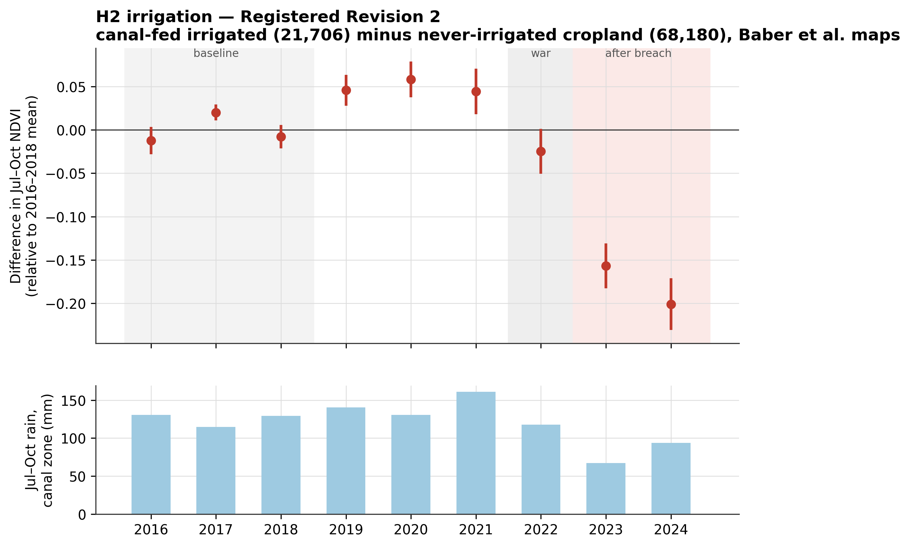

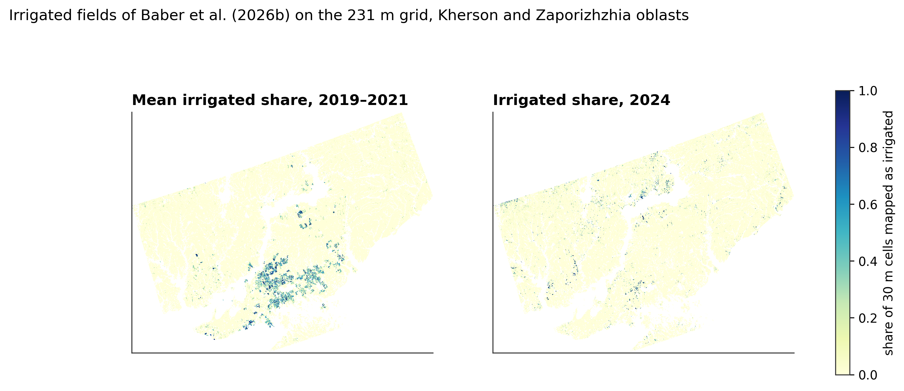

*Figure 11. Irrigated fields of Baber et al. (2026b) on the 231 m grid: mean share of each pixel mapped as irrigated in 2019–2021 (left) and in 2024 (right). The 2024 map is much less accurate than the earlier ones (Baber et al., 2026a).*

*Figure 9. Second revision, irrigation: canal-fed irrigated minus never-irrigated cropland (Baber et al., 2026b), each year compared with the 2016–2018 mean, with July–October rainfall in the canal zone below. Bars are 95% confidence intervals.*

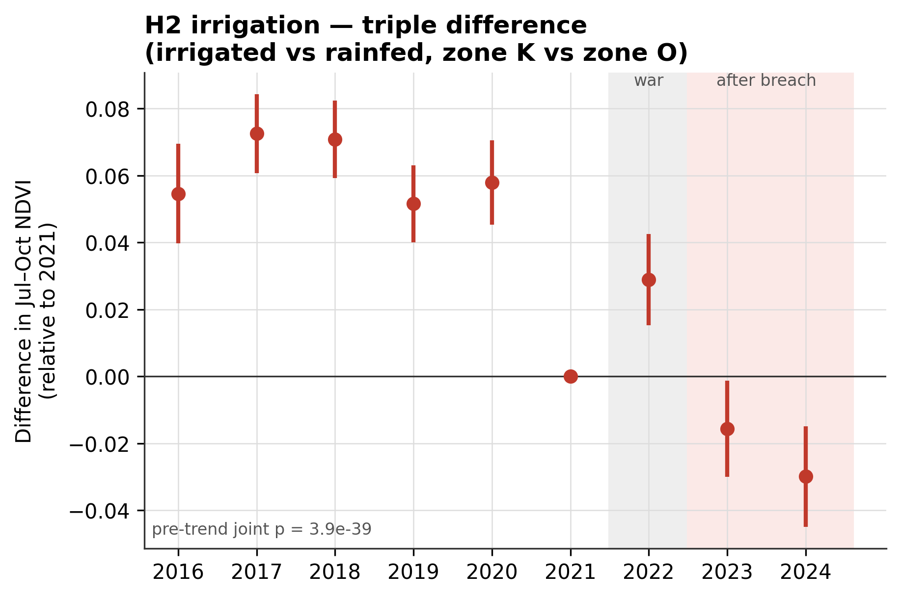

*Figure 3. Irrigated minus rainfed farmland, canal zone minus comparison zone, each year compared with 2021 (main plan). Bars are 95% confidence intervals.*

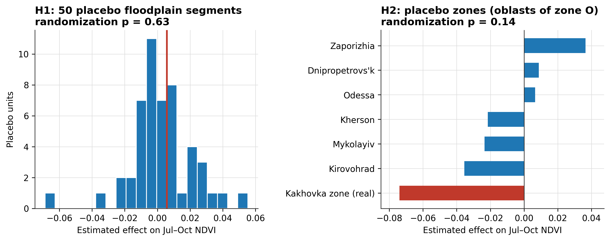

*Figure 4. Placebo tests. Left: flood estimate (red line) against 50 placebo floodplains. Right: irrigation estimate against six placebo oblasts.*

### 5.3 The reservoir bed (H3)

Before the breach the reservoir pixels were open water. Their July–October NDVI averaged 0.01–0.07, and only about 86–100 km² had NDVI above 0.3, mostly shallow edges and islands. (Only 42–60% of the bed pixels had a valid July–October value in each of these years, because open water is often flagged as unreliable.) After the breach this changed fast (Figure 5).

| | Mean July–October NDVI | Area with NDVI above 0.3 |
|---|---|---|
| 2016–2022 | 0.01–0.07 | about 86–100 km² |
| 2023 | 0.34 | 906 km² |
| 2024 | 0.55 | 1,574 km² (88% of valid pixels) |

This is a description; there is nothing to compare it with. The revision keeps only pixels that the yearly land-cover map calls land. Because that map still shows most of the bed as water in 2023, this leaves 244 km². On that land NDVI was 0.37 in 2023 and 0.55 in 2024, the same path. These numbers fit the field results of Kuzemko et al. (2025).

**Sentinel-2 check (second revision).** On the 231 km² of bed where both data sets can be compared, MODIS shows 211 km² with July–October NDVI above 0.3 in 2024 and Sentinel-2 (61 scenes, August median, 23 m) shows 172 km² (ratio 0.82). The check covers only the part of the bed that the 2023 land-cover map calls land.

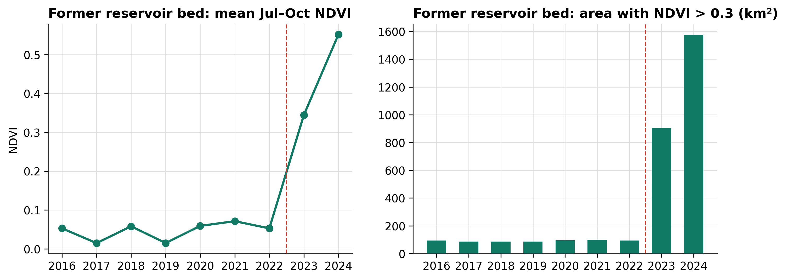

*Figure 5. The former Kakhovka reservoir bed: mean July–October NDVI and area with NDVI above 0.3.*

### 5.4 What made up Kherson Oblast's change (H4)

From 2021 to 2024, the July–October NDVI of Kherson Oblast changed by −0.029 relative to the comparison zone. Each part is compared with the same land-cover types (or the same irrigation group) in zone O; the reservoir bed, which has no counterpart there, enters with its raw change. Weighted by area, the parts are:

| Part of the oblast | Contribution (NDVI) |
|---|---|
| Land outside my exposure definitions | −0.024 |
| Irrigated farmland in the canal zone | −0.013 |
| Rainfed farmland in the canal zone | −0.002 |
| Flooded land | −0.0004 |
| Reservoir bed turning green | +0.010 |

The flood contributed almost nothing, because it covered under 2% of the oblast; flooded pixels themselves changed by −0.021 relative to zone O, against −0.030 for land outside the exposure definitions. The irrigated farmland of the canal zone contributed −0.013 (44% of the net change). The largest part, −0.024, came from land outside my exposure definitions (Figure 6).

This should not be read as "not caused by the dam". My exposure definitions miss irrigated farmland more than 5 km from the mapped canals (Section 5.2). The decomposition compares only two years, has no weather adjustment (2021 was wet, 2024 hot and dry) and has no uncertainty estimate.

In the revision, the water rule removes the whole reservoir bed by design, because every bed pixel's water share changed. The total is then −0.052, with −0.039 from land outside the exposure definitions.

**Second revision.** With the independent irrigation maps, a 2016–2018 baseline, weather adjustment and 95% block-bootstrap intervals (Figure 10), Kherson Oblast changed by −0.020 (−0.025 to −0.015) relative to the comparison area.

| Part of the oblast | Share of area | Contribution (95% interval) |
|---|---|---|
| Irrigated cropland (Baber maps) | 4% | −0.008 (−0.0085 to −0.0075) |
| Other cropland (partly irrigated, or not mapped) | 16% | −0.009 (−0.011 to −0.008) |
| All other land | 26% | −0.003 (−0.004 to −0.001) |
| Never-irrigated cropland | 50% | −0.000 (−0.003 to 0.002) |
| Flooded land | 2% | −0.000 (−0.0003 to 0.0001) |
| Reservoir bed | 2% | not estimable (open water before the breach) |

Previously irrigated cropland changed by −0.20 relative to comparison cropland and, though only 4% of the area, accounts for 39% of the oblast's change. Cropland that was never irrigated did not change at all. Because the irrigation contribution's interval excludes zero, the pre-registered rule reports H4 as more than descriptive; but the same caveat as for H2 applies, and the reservoir bed is not part of this total.

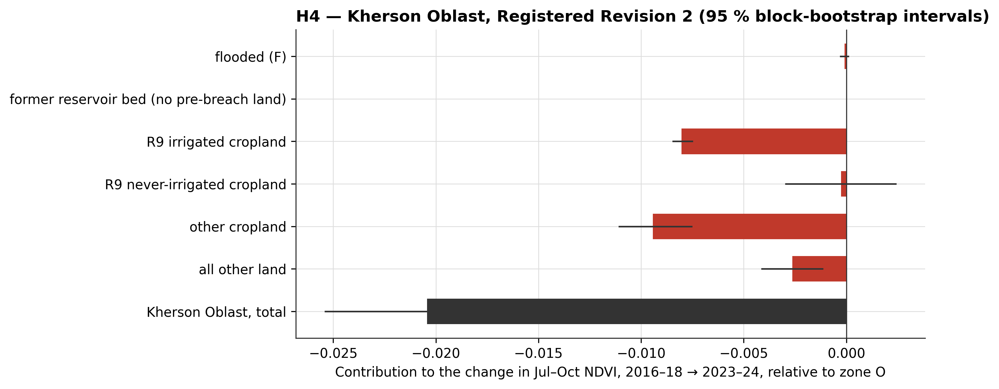

*Figure 10. Second revision: contributions to Kherson Oblast's change in July–October NDVI from 2016–2018 to 2023–2024, relative to the comparison area, with 95% block-bootstrap intervals.*

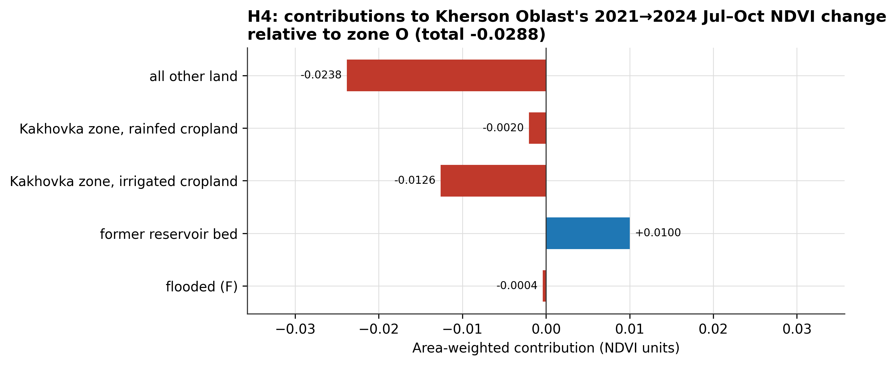

*Figure 6. Contributions to Kherson Oblast's change in July–October NDVI from 2021 to 2024, compared with zone O.*

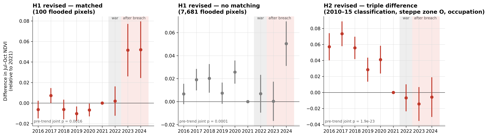

*Figure 7. Year-by-year results under the registered revision, compared with 2021. Left: flood, matched. Centre: flood, not matched. Right: irrigation.*

## 6. Discussion

### 6.1 Three pathways, three different answers

**The reservoir bed.** This is the largest change I measured. It is a description only: there is no comparison group, so it is not tested in the same way as the flood and irrigation results. About 1,500 km² became green within two seasons. Whether this is recovery or a new risk, for example from polluted sediment, needs field work (Kuzemko et al., 2025; Shumilova et al., 2025). NDVI only measures greenness.

**The flood.** I found no lasting loss of July–October greenness on the land the flood covered. In 2024 flooded land was, if anything, greener than similar land nearby. This fits a short flood that left moisture and sediment, although part of the gain in the matched samples may be regression to the mean (Section 5.1). The July–October window also cannot see damage during June itself. Floodplain wetlands are the exception: their greenness fell in every version of the analysis. After the dam's loss the river below it is no longer regulated, and its level dropped. This may have dried the wetlands more than the flood itself harmed them. My design cannot separate these two causes.

**Irrigated farmland.** Once irrigation was measured independently, the loss of greenness on formerly irrigated fields was large and began with the breach, matching the collapse of irrigation reported by Baber et al. (2026a). The test still fails a pre-registered condition, and no irrigated land outside the canal system was available as a comparison, so the result is named suggestive.

### 6.2 Why the first two designs could not test the irrigation loss

Baber et al. (2026a) and NASA Harvest (n.d.) show that irrigation in Kherson and Zaporizhzhia almost stopped after the breach. My first two designs did not isolate a matching fall in greenness. I see five reasons; the second revision addressed the first four.

1. **My irrigation measure is weak.** I marked a field as irrigated if it stayed green in July and August. In the steppe this mostly picks up summer crops such as maize and sunflower, which are often not irrigated. Even with 2010–2015 data, 95% of the steppe farmland classed as irrigated or rainfed outside the canal zone was classed as "irrigated". So my "irrigated" group is mostly "summer-cropped", not "irrigated".
2. **The trend was already moving.** The canal-zone contrast declined over 2016–2021, before the war.
3. **Weather was not allowed to change the contrast.** The irrigated–rainfed contrast is smallest in wet summers. The reference year 2021 was the wettest of the record and 2023–2024 the driest and hottest, but the models include weather only as separate terms (Section 5.2).
4. **The comparison land is partly exposed.** Districts next to the canal network, counted as comparison land, show the largest declines of all (Section 5.2).
5. **The comparison groups also changed.** After the breach, farmers in the canal zone moved to winter crops (NASA Harvest, n.d.). The same shift, for other reasons such as prices and war risk, may have happened in the comparison zone too. This would hide the difference.

The check in Section 5.2 confirms the first reason: the NDVI rule agreed with the field maps on a small minority of pixels. With the maps, the comparison inside the war zone, and weather allowed to change the contrast, the loss appears clearly (Figure 9). What remains open is the fifth reason and a sixth: without irrigated land that kept its water, the design cannot separate the loss of canal water from other changes that hit irrigated farms harder, such as damage to pumps and machinery or the risk of farming near the front line.

### 6.3 Why an oblast average misleads

Study 1's decline across Kherson Oblast was real. H4 shows that the greening reservoir bed hid part of it and that the flood covered too little of the oblast to matter. With independent irrigation maps, a small share of the oblast — fields that lost canal water — accounts for a large share of the decline, while cropland that was never irrigated did not change. An oblast average adds together a flood effect near zero, a farmland decline that started before the war, a large gain on the reservoir bed and broad declines elsewhere. Its size and even its sign depend on where the borders are drawn. To link change to an act, the units of analysis must match the physical footprint of each pathway.

### 6.4 What fixing the plan in advance changed

Two results would have been easy to change after seeing them.

- **The flood matching rule** kept only 1.8% of the flooded area. A looser rule chosen afterwards would have given a significant 2023 dip as the headline.
- **The irrigation naming rule** needed a placebo p that six oblasts could not give. A looser rule would have turned "suggestive" into "supported".

I kept both as written, reported the alternatives separately, and wrote each revision before collecting its data. Without these steps, this paper could have claimed a flood effect that the data do not show.

Fixing the plan in advance did not protect against weak choices: the first two plans used an irrigation measure that did not measure irrigation and did not let weather change the contrast. A registered plan fixes the choices; it does not make them right. The second revision corrected them and kept the same decision rule, which now names a large, well-timed irrigation result *suggestive* because its placebo test fails. I report it under that name.

### 6.5 What this means for legal use

- The change on the reservoir bed is large, well measured and clearly linked to the dam.
- No lasting effect of the flood on July–October greenness was detected, except in wetlands.
- Formerly canal-irrigated fields lost about a third of their summer greenness after the breach relative to never-irrigated cropland. Under the pre-registered rule this is suggestive evidence, not proof, that the loss of canal water caused it.

None of these results say anything about intent, military necessity or responsibility.

## 7. Limitations

- **Irrigation measure (first two analyses).** The NDVI proxy mostly captured summer cropping and agreed with independent maps on few pixels (Section 5.2). The second revision replaces it, but the maps have their own errors, are less accurate after 2022 and cover only two oblasts.
- **No comparison for the irrigation loss.** Almost all irrigated land in the mapped area depended on the canals, so the second revision compares irrigated with never-irrigated fields inside the war zone, not with irrigated fields that kept their water. War effects that hit irrigated farms harder cannot be separated from the loss of water.
- **Placebo test of the second revision.** The irrigated fields are defined by irrigation in 2019–2021 and were greener in those years, so the placebo test fails by construction as well as in fact. A design that defines irrigation before the baseline years would avoid this, but no field maps exist before 2019.
- **Parallel trends.** Pre-trend tests fail in most specifications. Causal readings of β should be made with care; the year-by-year results are more informative.
- **Flood matching.** Matching on terrain kept 59% of flooded pixels; the remaining low-lying floodplain has no unflooded look-alikes.
- **Scale of inference.** The flood is one connected area; for it the placebo floodplains are the credible guide. For the irrigation design the bootstrap with 39 district clusters is used; Conley errors to 100 km agree.
- **Decomposition.** H4 holds area shares fixed in the bootstrap, uses weather coefficients estimated in the irrigation model, and cannot include the reservoir bed, which was water before the breach.
- **Placebo tests.** Only six placebo oblasts were possible in the main plan and 15 districts in the revision.
- **Timing of the revisions.** Both revisions were written after earlier results were known; they are reported next to them, not instead of them. The plan and the first revision are timestamped by GitHub commits; the second revision only by a local commit and its checksum.
- **Re-running.** A full re-run on 16 October 2026 reproduced every sample size and verdict; coefficients changed from the fourth significant digit and some p-values slightly (Section 5 reports the re-run). The first run of the second revision missed one data-cleaning rule and was repeated; both are kept (`v2/DEVIATIONS.md`).
- **Exposure maps.**
  - UNOSAT flood maps are preliminary.
  - OpenStreetMap canals show today's mapping.
  - Land cover is from 2021.
  - The yearly water map for 2023 mixes months before and after the breach, and there is no 2024 map; this also limits the Sentinel-2 check to 231 km² of the bed.
- **War data.** VIINA is built from news reports, so some areas are under-reported. Mines and abandoned fields are not measured directly.
- **What NDVI can show.** NDVI shows greenness only, not crop yield, species, soil pollution or salt. The July–October window misses spring crops.
- **Sensor and time span.**
  - MODIS 250 m pixels mix land types at field edges.
  - One composite in the 2024 outcome window is missing.
  - Only two seasons after the breach are available.
- **Statistical tools.** The bootstrap, Conley and Rambachan–Roth steps were written for this study, not taken from standard software. They were checked against direct calculations but not against those packages.

## 8. Conclusion

I used a design fixed before seeing the data, and two registered revisions, each fixed before collecting its extra data. With them I found that:

- the drained reservoir bed became about 1,500 km² of green land within two seasons;
- flooded land showed no detectable lasting loss of July–October greenness, except for floodplain wetlands, whichever way the comparison land was chosen;
- fields that had been irrigated from the canals lost about a third of their summer greenness after the breach relative to never-irrigated cropland, and account for much of Kherson Oblast's decline. The pre-registered rule names this suggestive, because the fields were already diverging in the years used to identify them and no irrigated land outside the canal system was available for comparison.

An oblast average hides changes of opposite sign. Satellite evidence of war damage is most useful when the analysis follows the physical footprint of each pathway, compares like with like inside the conflict zone, allows for weather, and is fixed in advance.

## Data and Code Availability

All code, both analysis plans, the list of deviations and all results are at github.com/sakshimaske303-commits/ECOCIDE.

- `v2/01`–`08` download and prepare the data.
- `v2/analysis/run_all.py` reproduces the main-plan results (`outputs/v2/study2_summary.json`).
- `v2/analysis/run_revision.py` reproduces the revision (`outputs/v2/r1_summary.json`).
- `v2/analysis/x1_review_diagnostics.py` reproduces the exploratory checks of Section 4.9 (`outputs/v2/x1_review_diagnostics.json`).
- `v2/09`–`11` download the data of the second revision, and `v2/analysis/run_revision2.py` reproduces it (`outputs/v2/r2_summary.json`).
- `tests/test_v2lib.py` and `tests/test_r2lib.py` check the estimation engine and the second revision's helpers against direct calculations.
- Study 1 is reproduced by `generate_model_results.py`.

The input data are open: MODIS, WorldCover, Impact Observatory, Copernicus DEM and Sentinel-2 data from the Microsoft Planetary Computer; ERA5-Land from the Copernicus Climate Data Store; UNOSAT layers from UNITAR/UNOSAT; canals from OpenStreetMap (ODbL); conflict data from VIINA; irrigation maps from Zenodo (Baber et al., 2026b; CC BY 4.0).

## References

Atılgan Pazvantoğlu, C. (2025). Ecocide as a separate crime under the Rome Statute: A legal analysis of the discourse. *Environmental Policy and Law*, 55(2–3), 57–67. https://doi.org/10.1177/18785395251351171

Baber, S., Skakun, S. V., Sadeh, Y., Shumilo, L., Oliinyk, O., Hosseini, M., Wagner, J., Khan, A. Q., Nair, S., Kotcharlakota, A., & Becker-Reshef, I. (2026a). A semi-supervised multi-sensor remote sensing pipeline for mapping irrigation dynamics in ground-truth deficient conflict zones: A case study of the Kakhovka Dam failure. *Frontiers in Remote Sensing*, 7, 1920951. https://doi.org/10.3389/frsen.2026.1920951

Baber, S., Skakun, S., Sadeh, Y., Shumilo, L., Oliinyk, O., Hosseini, M., Wagner, J., Khan, A. Q., Sreedharan Nair, S., Kotcharlakota, A., & Becker-Reshef, I. (2026b). *Irrigation of Kherson and Zaporizhzhia 2019–2025* (Version 1) [Data set]. Zenodo. https://doi.org/10.5281/zenodo.22036773

Cameron, A. C., Gelbach, J. B., & Miller, D. L. (2008). Bootstrap-based improvements for inference with clustered errors. *The Review of Economics and Statistics*, 90(3), 414–427. https://doi.org/10.1162/rest.90.3.414

Conley, T. G. (1999). GMM estimation with cross sectional dependence. *Journal of Econometrics*, 92(1), 1–45. https://doi.org/10.1016/S0304-4076(98)00084-0

Conley, T. G., & Taber, C. (2011). Inference with "difference in differences" with a small number of policy changes. *The Review of Economics and Statistics*, 93(1), 113–125. https://doi.org/10.1162/REST_a_00049

Daw, J. R., & Hatfield, L. A. (2018). Matching and regression to the mean in difference-in-differences analysis. *Health Services Research*, 53(6), 4138–4156. https://doi.org/10.1111/1475-6773.12993

Didan, K. (2021). *MODIS/Terra Vegetation Indices 16-Day L3 Global 250m SIN Grid V061* [Data set]. NASA EOSDIS Land Processes DAAC. https://doi.org/10.5067/MODIS/MOD13Q1.061

GADM. (2022). *GADM database of global administrative areas, version 4.1*. https://gadm.org

Holm, S. (1979). A simple sequentially rejective multiple test procedure. *Scandinavian Journal of Statistics*, 6(2), 65–70.

Jones, K. W., & Lewis, D. J. (2015). Estimating the counterfactual impact of conservation programs on land cover outcomes: The role of matching and panel regression techniques. *PLoS ONE*, 10(10), e0141380. https://doi.org/10.1371/journal.pone.0141380

Karra, K., Kontgis, C., Statman-Weil, Z., Mazzariello, J. C., Mathis, M., & Brumby, S. P. (2021). Global land use/land cover with Sentinel 2 and deep learning. In *2021 IEEE International Geoscience and Remote Sensing Symposium (IGARSS)* (pp. 4704–4707). https://doi.org/10.1109/IGARSS47720.2021.9553499

Killean, R. (2025). Ecocide's evolving relationship with war. *Environment and Security*. Advance online publication. https://doi.org/10.1177/27538796251347111

Kroker, P. (2015, April 23). Satellite imagery as evidence for international crimes. *International Justice Monitor*. https://www.ijmonitor.org/2015/04/satellite-imagery-as-evidence-for-international-crimes/

Kussul, N., Shelestov, A., Yailymov, B., Yailymova, H., Lemoine, G., & Deininger, K. (2025). Assessment of war-induced agricultural land use changes in Ukraine using machine learning applied to Sentinel satellite data. *International Journal of Applied Earth Observation and Geoinformation*, 140, 104551. https://doi.org/10.1016/j.jag.2025.104551

Kuzemko, A. A., Prylutskyi, O. V., Kolomytsev, G. O., Didukh, Ya. P., Moysiyenko, I. I., Borsukevych, L. M., Chusova, O. O., & Khodosovtsev, O. Ye. (2025). Initial stages of revegetation at the bottom of the drained Kakhovka Reservoir (Ukraine): Synthesis of field surveys and remote sensing. *Ukrainian Botanical Journal*, 82(5), 488–501. https://doi.org/10.15407/ukrbotj82.05.488

Lischenko, L., Kozlova, A., & Andreiev, A. (2025). Mapping of the spatiotemporal transformations of the former Kakhovka reservoir bed after dam destruction using Sentinel-2 satellite imagery. *Ukrainian Journal of Remote Sensing*, 12(4), 29–37. https://doi.org/10.36023/ujrs.2025.12.4.296

Muñoz-Sabater, J., Dutra, E., Agustí-Panareda, A., et al. (2021). ERA5-Land: A state-of-the-art global reanalysis dataset for land applications. *Earth System Science Data*, 13(9), 4349–4383. https://doi.org/10.5194/essd-13-4349-2021

NASA Harvest. (n.d.). *Tracking irrigation loss in southern Ukraine after the Kakhovka Dam collapse*. Retrieved 28 September 2026, from https://www.nasaharvest.org/news/tracking-irrigation-loss-in-southern-ukraine-after-the-kakhovka-dam-collapse

OpenStreetMap contributors. (2026). *OpenStreetMap* [Data set, extracted 24 September 2026 through the Overpass API]. https://www.openstreetmap.org

Ozdogan, M., Yang, Y., Allez, G., & Cervantes, C. (2010). Remote sensing of irrigated agriculture: Opportunities and challenges. *Remote Sensing*, 2(9), 2274–2304. https://doi.org/10.3390/rs2092274

Pichura, V., & Potravka, L. (2025). Impact of war on natural and climatic transformation of territories in the irrigation zone of Ukraine. *Discover Applied Sciences*, 7, 783. https://doi.org/10.1007/s42452-025-07404-4

*Prosecutor v. Ahmad Al Faqi Al Mahdi*, ICC-01/12-01/15, Judgment and Sentence (International Criminal Court, Trial Chamber VIII, 27 September 2016).

Rambachan, A., & Roth, J. (2023). A more credible approach to parallel trends. *The Review of Economic Studies*, 90(5), 2555–2591. https://doi.org/10.1093/restud/rdad018

Rome Statute of the International Criminal Court, July 17, 1998, 2187 U.N.T.S. 90.

Roth, J., Sant'Anna, P. H. C., Bilinski, A., & Poe, J. (2023). What's trending in difference-in-differences? A synthesis of the recent econometrics literature. *Journal of Econometrics*, 235(2), 2218–2244. https://doi.org/10.1016/j.jeconom.2023.03.008

Shafroth, P. B., Friedman, J. M., Auble, G. T., Scott, M. L., & Braatne, J. H. (2002). Potential responses of riparian vegetation to dam removal. *BioScience*, 52(8), 703–712. https://doi.org/10.1641/0006-3568(2002)052[0703:PRORVT]2.0.CO;2

Shults, R. (2025). A complex study of the Kahovka Reservoir changes after dam collapse. *The International Archives of the Photogrammetry, Remote Sensing and Spatial Information Sciences*, XLVIII-5/W3, 117–123. https://doi.org/10.5194/isprs-archives-XLVIII-5-W3-2025-117-2025

Shumilova, O., Sukhodolov, A., Osadcha, N., et al. (2025). Environmental effects of the Kakhovka Dam destruction by warfare in Ukraine. *Science*, 387(6739), 1181–1186. https://doi.org/10.1126/science.adn8655

Skakun, S., Justice, C. O., Kussul, N., Shelestov, A., & Lavreniuk, M. (2019). Satellite data reveal cropland losses in South-Eastern Ukraine under military conflict. *Frontiers in Earth Science*, 7, 305. https://doi.org/10.3389/feart.2019.00305

Stop Ecocide International. (2024, September 9). *Mass destruction of nature reaches International Criminal Court (ICC) as Pacific island states propose recognition of "ecocide" as international crime*. https://www.stopecocide.earth/2024/mass-destruction-of-nature-reaches-international-criminal-court-icc-as-pacific-island-states-propose-recognition-of-ecocide-as-international-crime

UNITAR/UNOSAT. (2023). *Flood extent analysis following the destruction of the Nova Kakhovka dam, Khersonska Oblast, Ukraine (event code FL20230606UKR)* [Data set]. United Nations Institute for Training and Research. https://unosat.org

Vyshnevskyi, V., Shevchuk, S., Komorin, V., et al. (2023). The destruction of the Kakhovka dam and its consequences. *Water International*, 48(5). https://doi.org/10.1080/02508060.2023.2247679

Wagner, J., Nair, S. S., Skakun, S., Duncan, E. C., Li, F., Oliinyk, O., Nerry, F., Rehbinder, J., & Becker-Reshef, I. (2025). Monitoring cropland cultivation, abandonment, fallowing and recultivation dynamics with regard to conflict intensity in war-affected Ukraine. *Science of Remote Sensing*, 12, 100326. https://doi.org/10.1016/j.srs.2025.100326

Wang, B. Y., Raymond, N., Gould, G., & Baker, I. (2013). Problems from hell, solution in the heavens? Identifying obstacles and opportunities for employing geospatial technologies to document and mitigate mass atrocities. *Stability: International Journal of Security and Development*, 2(3), Article 53. https://doi.org/10.5334/sta.cn

Witmer, F. D. W. (2015). Remote sensing of violent conflict: Eyes from above. *International Journal of Remote Sensing*, 36(9), 2326–2352. https://doi.org/10.1080/01431161.2015.1035412

Yang, Q., Shen, X., He, K., Zhang, Q., Helfrich, S., Straka III, W., Kellndorfer, J. M., & Anagnostou, E. N. (2024). Pre-failure operational anomalies of the Kakhovka Dam revealed by satellite data. *Communications Earth & Environment*, 5, 230. https://doi.org/10.1038/s43247-024-01397-5

Zanaga, D., Van De Kerchove, R., Daems, D., et al. (2022). *ESA WorldCover 10 m 2021 v200* [Data set]. Zenodo. https://doi.org/10.5281/zenodo.7254221

Zhukov, Y. M. (2023). Near-real time analysis of war and economic activity during Russia's invasion of Ukraine. *Journal of Comparative Economics*, 51(4), 1232–1243. https://doi.org/10.1016/j.jce.2023.06.003. VIINA data: https://github.com/zhukovyuri/VIINA
